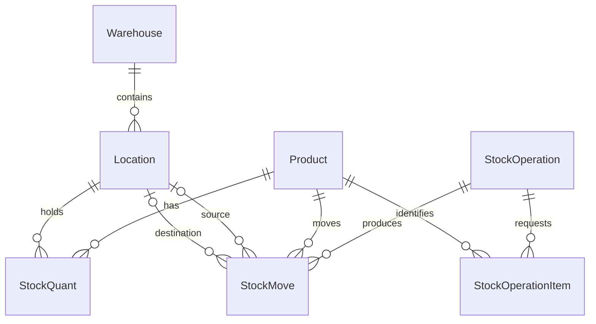
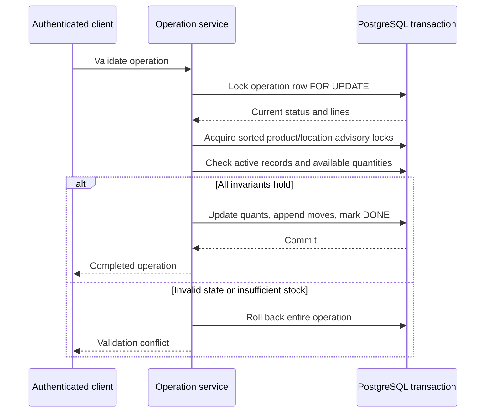

# StockSense

**Transactional inventory management with a movement ledger and concurrency-safe stock updates.**

StockSense is a Next.js application backed by PostgreSQL and Prisma for one shared inventory workspace. Receipts, deliveries, internal transfers and physical counts update current quantities and historical movements through the same transaction engine. Catalog management, warehouse locations, authentication and browser workflows surround that engine.

[Inventory engine](src/server/inventory/) · [Database model](prisma/schema.prisma) · [Integration verification](scripts/verify-integration.ts) · [Review evidence](docs/REVIEW.md)

## Inventory model

`StockQuant` holds the current quantity for a unique product/location pair; `Product` does not carry an authoritative on-hand total. `StockMove` records completed movement history, linked to its originating operation. Both use PostgreSQL `Decimal(18,4)` through Prisma Decimal arithmetic, avoiding binary floating-point arithmetic for stock quantities.



Operation headers carry source/destination, partner and creator; line items carry requested and processed quantities. Locations form a warehouse hierarchy. Categories, units of measure and reorder rules provide catalog and replenishment context. Foreign keys retain references to historical records.

## Operation lifecycle and transaction boundary

Operations progress through `DRAFT → WAITING → READY → DONE` (a draft may also move directly to ready); eligible unfinished operations can be canceled. Header edits, line edits, readiness, validation and cancellation all acquire the operation row lock. Validation rechecks the persisted state after acquiring that lock, so two competing requests cannot both publish the same operation. A repeat validation is rejected by the transition rules; the API does not promise general idempotency keys for arbitrary requests.



The [validator](src/server/inventory/validate-operation.ts) aggregates repeated product lines before checking delivery/transfer availability. A transfer decrements its source and increments its destination atomically. All affected product/location pairs are deduplicated and sorted before transaction-scoped advisory locking; this also serializes updates when a quant row has not yet been created. The [quantity service](src/server/inventory/stock-quant.ts) enforces nonnegative balances.

Receipts, deliveries and transfers require positive quantities. An adjustment records a physical count, including zero, and applies the difference from the locked current balance. An unchanged count completes with zero processed quantity and no fabricated movement. A failed line rolls back the full operation rather than leaving partial transfers or an inconsistent ledger.

## Authentication and validation

Protected API handlers and server pages resolve the current user before accessing inventory services. Signup requires email verification; password reset, OTP consumption, login throttling and session invalidation have regression coverage. Request schemas validate input before the database transaction, while business invariants are checked again against locked records. User roles are stored, but this version is a shared workspace: role names do not establish tenant isolation or a comprehensive role-based authorization system.

## Verification approach

The integration verifier exercises real PostgreSQL transactions, including controlled concurrent interleavings, competing edits/validation, stock depletion, unchanged counts and authentication races. HTTP and Playwright workflows cover the externally visible signup-to-inventory journey using a loopback SMTP fixture. These are correctness checks; no throughput or production load result is claimed. Commands and disposable-database safeguards follow below.

## Run locally

Requirements: Node.js 20.9+ and PostgreSQL 15+.

```sh
npm ci
cp .env.example .env
# Set DATABASE_URL and a unique AUTH_SECRET (openssl rand -hex 32).
npx prisma generate
npm run db:migrate
npm run dev
```

Visit `http://localhost:3000`, sign up, and verify your email. Without SMTP in development, the local server prints the verification code. Production requires real SMTP credentials. No usable demo password is committed. The optional `npm run db:seed` adds development catalog/warehouse/partner fixtures; create your own login using signup. Its development user intentionally has no usable password.

A blank database is supported: Products → Add Product lets you create the first category and unit, then Warehouses and Locations establish where stock lives. Supplier/customer selection reads actual partners; both are optional.

## Finals demonstration

See [the demo script](docs/DEMO.md) for receive 100 → transfer 30 → deliver 20 → count 8, leaving 70 in Rack A and 8 in Rack B. Every operation follows Draft → Ready → Done; only validation changes stock. Failed deliveries leave stock and the ledger unchanged.

## Deploy

1. Configure a dedicated database, a unique `AUTH_SECRET` with at least 32 characters, and SMTP variables from `.env.example`.
2. Set `APP_ORIGIN` to the exact public origin, without a trailing slash, and serve over HTTPS.
3. Set `SIGNUP_ALLOWED_EMAILS` to the approved team addresses. Production registration is closed to other addresses. Every approved account shares the workspace and can operate inventory; the role field does not implement tenant isolation or differentiated permissions.
4. Run `npm ci`, then `npm run db:migrate` as a controlled release step, then `npm run build` and `npm start`. The build no longer runs migrations against your database.
5. For a controlled finals demo with disposable data only, `ALLOW_PUBLIC_SIGNUP=true` enables open registration. Keep it false for a real workspace.

The session-version migration invalidates legacy sessions; users must sign in again. Password resets revoke all existing sessions. Failed login attempts are limited per normalized email to 20 attempts per 15 minutes, shared across application instances; a correct password remains usable so an attacker cannot lock out a known address. Put broader IP/request throttling at your hosting edge. API writes check origin; all catalog and inventory endpoints require a verified session. External production SMTP requires TLS; loopback relays are permitted for local integration tests.

Before real business use, configure database backups and restore drills, monitoring and log retention, your approved membership/role policy, and edge throttling. This repository does not include stock reservations, costing, automatic purchasing, multi-company tenancy, or an Odoo connector.

## Verification

Use a disposable database whose name contains `_test_` or `_review_`. Verification inserts inventory records that deliberately retain audit history. Never point these scripts at real inventory.

```sh
npx prisma generate
npm run db:migrate
npm run lint
npm run typecheck
npm run verify:auth
npm run verify:inventory
npm run verify:integration
npm audit
```

Set `DATABASE_URL` and `AUTH_SECRET` in the environment before running verification. `verify:auth` uses development email capture and must run without production SMTP configuration. The integration verifier exercises every protected API handler, deterministic transaction interleavings, unchanged physical counts, OTP concurrency and login limits.

### Full HTTP and browser workflow

Start a test mail relay in one terminal:

```sh
SMTP_TEST_OUTBOX=/tmp/stocksense-test-mail.jsonl node scripts/test-smtp.mjs
```

Build the application, then start it against the same disposable database in a second terminal, with `AUTH_SECRET`, `ALLOW_PUBLIC_SIGNUP=true`, `SMTP_HOST=127.0.0.1`, `SMTP_PORT=3188`, `SMTP_USER=test`, `SMTP_PASSWORD=test`, and `SMTP_FROM=stocksense@example.test` set:

```sh
npm run build
npm start -- --hostname 127.0.0.1 --port 3187
```

In a third terminal, set the same `DATABASE_URL`, then run:

```sh
SMTP_TEST_OUTBOX=/tmp/stocksense-test-mail.jsonl npm run test:e2e -- api-workflow
npx playwright install chromium
SMTP_TEST_OUTBOX=/tmp/stocksense-test-mail.jsonl npm run test:e2e -- workflow.spec.ts
```

The mail fixture binds to loopback only, captures test OTP messages locally, and is not a real mail-deliverability test. Playwright needs OS permission to launch Chromium. When that is restricted, the HTTP integration test still runs; verify visible browser interactions separately. See [the review and evidence](docs/REVIEW.md).

## Continuous integration

`.github/workflows/verify.yml` runs lint, type checks, migrations, auth/inventory/concurrency regressions, the dependency audit, the production build, and both HTTP and Chromium workflows against a disposable PostgreSQL service and loopback mail relay. It runs for pull requests and pushes to main or codex branches. No production secrets or deployment are involved.

The TypeScript ESLint parser uses a scoped `minimatch` override (`^11.0.1`, locked to 11.0.5) for the [glob-pattern amplification advisory](https://github.com/advisories/GHSA-g3hv-75wg-m249). This changes the affected development-tool dependency without changing the Next.js or ESLint versions. A fresh 2026-11-07 clean install reported zero npm audit findings; lint, route/type generation and the production build passed locally. Database and browser workflow acceptance is checked separately by the CI workflow above.

## Source map

| Path | Responsibility |
|---|---|
| [src/server/inventory/](src/server/inventory/) | Quantity locking, movement creation and operation validation |
| [src/server/operations/](src/server/operations/) | Operation mutations and shared record loading |
| [src/app/](src/app/) | Pages and HTTP route handlers |
| [prisma/](prisma/) | Relational schema and migrations |
| [scripts/](scripts/) | Auth, inventory, integration and SMTP verification |

Documentation basis: [`94075b7`](https://github.com/akilanpl/StockSense/tree/94075b718ebe8add63bdbcfef3136fcd3f3906ad). Recorded evidence describes its own source versions; updating this README does not rerun the database or browser campaigns.
