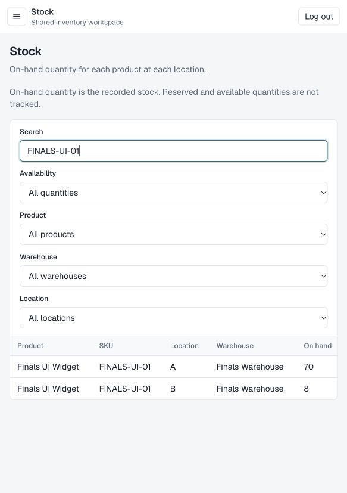

# StockSense review and finals hardening

Date: 28 October 2026. Baseline: `akilanpl/StockSense`, `main`, commit `a98eb42`. The implementation is prepared on `codex/finals-integration` for review. No production deployment is part of this change.

## Outcome

The inventory happy path was exercised through the real browser UI and through the running production server's HTTP endpoints:

```text
Create product/category/unit
  -> Receive 100 into A -> Ready -> Validate
  -> Transfer 30 A to B -> Ready -> Validate
  -> Deliver 20 from B -> Ready -> Validate
  -> Count 8 in B -> Ready -> Validate
  -> Stock: A=70, B=8
  -> Ledger: receipt 100, transfer 30, delivery 20, adjustment 2 out
```

A subsequent delivery of 9 from B is rejected with HTTP 409. It stays Ready and writes no movement. Posting the same operation twice is rejected. An unchanged physical count completes without a zero movement. The browser also created a second product successfully, confirming that the creation form remains usable after success.

Status: **DONE_WITH_CONCERNS** for the scoped demo fixes. This is not a certification that every feature, deployment configuration or production failure mode is verified.

## Scope and method

Reviewed authentication/session/OTP services, API handlers and shared request handling, the inventory engine, operation mutations, schema and migrations, catalog creation, operation forms/details, server-rendered stock/dashboard/history, UI primitives, package/build configuration, seed behavior and existing verification scripts. Used real PostgreSQL in a separately created local review database. No business database was accessed or modified. SMTP was verified against a loopback test relay, not an external provider.

The requested gstack autoplan workflow supplied intake/scoping and exposed that the original request was a repository review rather than a pre-existing feature plan. You selected office-hours, then established a hackathon-finals goal and asked to fix the happy path and overall integration. Work proceeded on that concrete implementation scope. The full sequential CEO/design/DX/engineering autoplan pipeline, independent phase reviewers and final autoplan approval gate were **not completed**. No cross-model consensus or autoplan approval is claimed. Strix scan findings were not available because its connection required reauthentication; these are code-review and test findings, not Strix results.

## Findings and fixes

Severity describes the original code risk in this application, not a vendor CVSS score. “Fixed” means changed locally and covered by the evidence below; the branch/PR records their publication.

| Priority | Finding and evidence | Remedy | State |
|---|---|---|---|
| Critical | Catalog writes such as `src/app/api/products/route.ts` POST had no session check; inventory/catalog reads were also exposed. `withApi` only normalized errors. Workspace page protection did not protect the API. | `src/server/http.ts:16` authenticates by default. Only explicit public auth actions use `withPublicApi`. All 28 inventory/catalog exported handlers reject anonymous requests. | Fixed |
| Critical | The installed Next.js 16.3.6 matched current critical advisory ranges, including GHSA-2464-fhr4-w9xw and GHSA-673q-mjm6-r5xr. Audit also found high advisories in dependencies. | Upgraded Next.js/eslint-config-next to 16.4.3, Zod and Nodemailer to patched versions, refreshed compatible transitive dependencies, and overrode only `@prisma/config`'s deepmerge-ts dependency to 8.x. Prisma generation, migrations, checks and production build pass with the override. | Fixed; final audit reports zero known advisories |
| High | Operation cancellation/header/line writes checked state before writing without taking validation's parent row lock. A cancellation waiting behind a successful posting could overwrite Done with Canceled. | `src/server/operations/operations.ts:85` and all other operation mutations acquire the same parent `FOR UPDATE` lock inside their transaction and check state after acquiring it. | Fixed; deterministic interleaving tests |
| High | OTP attempts and consumption read an unprotected challenge then wrote unconditionally. Parallel requests could reuse a code or lose attempt increments. | `src/server/auth/otp.ts:33` serializes issuance/consumption on the user's row. Failed-attempt counters commit before errors are returned. Reset credential mutation happens in the consumption transaction. | Fixed; parallel reuse and attempt-limit tests |
| High | Password reset changed the password but existing signed seven-day cookies remained valid. | Session version in the signed token is checked against the database; reset increments it. Added migration `20261028040000_session_version`. | Fixed; old-session rejection and new-login tests |
| High | Public registration created a manager in a globally shared inventory workspace. | Production signup now requires an address in `SIGNUP_ALLOWED_EMAILS`. Open signup requires deliberate `ALLOW_PUBLIC_SIGNUP=true` for a controlled demo. | Fixed for a trusted shared workspace; differentiated roles/tenants remain out of scope |
| High | Login had no per-account attempt limit. | Database-backed atomic limit of 20 attempts per normalized email per 15 minutes; migration `20261028043000_login_limits`. | Fixed; 22 concurrent calls admit exactly 20. Edge/IP protection still required |
| Medium | First-product creation could not discover any unit on an empty database because units were extracted from products. | Added authenticated unit GET/POST and client methods. Product creation supports a new category and a new unit; product editing reads actual units. | Fixed; HTTP creation plus browser creation of two products |
| Medium | Supplier/customer forms offered fixed development UUIDs that did not exist without seeding. | Added authenticated partner lookup and replaced fixture options with real supplier/customer records. Optional partner selection works on an unseeded database. | Fixed; API/browser flow without partners |
| Medium | Securing reads would break server pages: their internal HTTP calls carried no session cookie and derived a target from forwarded host headers. | Dashboard, Stock and Move History now check the current user and read the same server services directly, without making a credential-bearing self-request. | Fixed; all three server pages returned rendered data over HTTP; visible stock/history checked |
| Medium | A physical count equal to recorded stock rejected the entire adjustment, including unrelated lines. | `src/server/inventory/validate-operation.ts:201` accepts unchanged lines and records zero processed difference without a fake move. | Fixed |
| Medium | Out-of-stock dashboard counted only existing zero-quantity rows and missed never-stocked products. Low-stock lookup made one query per rule. | Count active products with no positive balance; batch quantity lookup for reorder rules; clarify KPI copy. | Fixed; database integration check |
| Medium | Oversized JSON, excessive text/line inputs, quantities beyond Decimal(18,4), and malformed UUIDs could reach database/internal errors. | Bounded JSON streaming to 1 MiB, limited text/line sizes and quantity precision/range, validated UUID route parameters and catalog query filters. | Fixed; type/build plus HTTP invalid-ID checks. Not every boundary has a dedicated regression |
| Medium | Modal ARIA claimed modality without actual focus confinement or focus restoration. Fields did not associate error messages. | Native modal dialog, unique labels, Escape/click-outside handling, height/scroll limit, and field error associations. | Fixed; actual creation dialogs exercised in the in-app browser at a narrow viewport |
| Medium | Product creation relied on parent remounting to clear its pending state. Delivery loaders could silently accept failed location/product fetches. | Reset creation state; delivery loading now uses the typed API client and fails visibly as a unit. | Fixed; second browser product creation and delivery workflow |
| Medium | Building the app also ran `prisma migrate deploy` against whichever database was configured. README ended in an unclosed architecture fence and omitted usable setup instructions. | Separated `db:migrate` from build, documented environment/deployment/tests/demo. | Fixed |
| Low | Global top bar displayed “No warehouse selected” despite there being no global warehouse selector. | Replaced with accurate shared-workspace copy; filtering remains on each inventory screen. Dashboard pending references now link to their operation. | Fixed |

## Verification actually performed

| Check | Result and limits |
|---|---|
| `npm run lint` | Pass, no warnings in the final run |
| `npm run typecheck` | Pass; generates Next route types first, so a clean checkout works |
| `prisma generate` and `npm run db:migrate` | Pass against the disposable PostgreSQL database, with all six migrations |
| `npm run build` | Pass using the default Next.js 16.4.3 Turbopack production build |
| `npm run verify:auth` | Pass: signup, verification, login/logout/current user, password reset, session revocation, server-derived operation creator |
| `npm run verify:inventory` | Pass: receipts, deliveries, transfers, adjustments including zero, insufficient stock, rollback/state/ledger and hierarchy checks |
| `npm run verify:integration` | Pass: all 28 inventory/catalog handlers require auth; deterministic validation/cancel and ready/edit interleavings; concurrent oversell rejection; unchanged counts; OTP single use and five-attempt ceiling; atomic login throttle; never-stocked dashboard count |
| HTTP integration on the production build | Pass: actual signup and Nodemailer delivery to loopback SMTP, OTP verification, first unit/category/product creation, warehouse/locations, all four operations, ledger totals, duplicate posting, insufficient stock, invalid IDs, rendered Dashboard/Stock/History, reset and old-session revocation |
| Production registration and origin checks | Pass: default production signup rejects unapproved email; cross-origin mutation rejects; legitimate browser same-origin login works even when Next uses an internal hostname |
| In-app browser smoke | Pass: login, two product creations, receipt 100, transfer 30, delivery 20, count 8, final Stock balances 70/8, four visible movement records |
| Full automated Playwright browser specification | Local execution was blocked: macOS denied Chromium's MachPort bootstrap before any page action. The browser specification is included for an unrestricted host. CUA browser smoke is separate evidence, not a claim that this automated suite passed. |
| `npm audit` | Final result: 0 critical, 0 high, 0 moderate, 0 low advisories. Registry snapshot on 28 October 2026; this does not prove application security |
| External production SMTP, public HTTPS hosting, load/backup recovery | Not verified |

The full browser smoke ran before the dependency update; the final Next.js 16.4.3 build was rechecked through the HTTP lifecycle test and the in-app stock screen with the same 70/8 balances. Test OTP email never went to a real user. The local mail relay and database fixtures are testing tools, not production services.



## Error and recovery map

| Trigger | Contract/recovery | Verification |
|---|---|---|
| Missing/expired/revoked session | HTTP 401, no inventory work; sign in again | Auth and anonymous-handler tests |
| Cross-origin mutation | HTTP 403, no handler mutation | Runtime origin probes |
| Invalid JSON/media/oversized body/UUID | HTTP 400/415/413 as appropriate, no service call | UUID HTTP coverage; body limits inspected |
| Duplicate SKU/unit/reference | HTTP 409 with caller-safe conflict message; choose an existing unit or another identifier | Product flow exercises normal creation; comprehensive conflict matrix remains future coverage |
| Insufficient stock | HTTP 409; transaction rolls back, operation stays Ready, no new move | Service and HTTP tests |
| Competing cancel/edit/post | Parent lock, then fresh state check; losing incompatible mutation gets 409 | Deterministic database schedules |
| Wrong/reused/expired OTP | HTTP 400/429; attempts persisted, code cannot be reused | Auth and concurrency checks |
| Too many logins | HTTP 429; wait until the 15-minute window expires | Concurrent shared-limit test |
| SMTP unavailable | Bounded connection/greeting/socket timeout; visible 503; use resend/retry as appropriate | Successful local SMTP transport verified; external outage behavior inspected |
| Unexpected API failure | Generic public 500 plus `X-Request-Id`; server records operation/path/error class without request credentials | Wrapper inspected; central monitoring remains deployment work |

## Production work that remains

These are concrete gaps, not reasons to redo the working demo.

1. **Membership, roles and multi-company boundaries.** All approved users currently share and can mutate one workspace; role labels are informational. Keep signup allowlisted. If staff must have narrower privileges or companies must be isolated, enforce that policy at every service/query and test cross-user access before introducing those users. Owner: application lead.
2. **Pagination/search completeness.** `listOperations` takes the latest 100 and `listMoves` the latest 200. Client filtering cannot discover older omitted records. Add cursor pagination and server-side search with counts; test 101+ operations and 201+ moves. Owner: inventory/API lead.
3. **Hierarchy concurrency.** Location parent checks reject sequential cycles, but `src/server/catalog/locations.ts` traverses and updates without a shared tree transaction lock. Concurrent reciprocal parent edits need a warehouse/tree-level lock or serializable transaction plus a regression. Owner: catalog lead.
4. **Operational ownership.** Configure edge/IP throttling, TLS/proxy trust, external SMTP deliverability, database backup and restore exercises, alerting, request-log retention and rollback. Prune expired `login_limits` records and old OTPs on a schedule. Owner: deployment operator.
5. **Audit/scale depth.** The ledger records operation creator and movements but lacks separate validator/canceler attribution and a complete user-change audit. Database triggers stop deletion of moves but do not make every historical field immutable to privileged direct SQL. Add the audit guarantees you need and use least-privilege database credentials. Owner: security/data lead.
6. **Automated release coverage.** Run the included browser suite on CI or another host that can launch Chromium. Add explicit boundary/error/SMTP-failure/mixed-count regressions and deployed-browser testing. A GitHub Actions workflow now runs these checks, including Chromium, on pushes and pull requests; consult its run for the current result. Owner: release lead.
7. **Feature boundaries.** Reorder rules exist in the schema but have no full management UI; partner lookup exists but no partner-management UI was added. Stock reservations, costs, purchasing automation, offline mode and an Odoo connector are not implemented. Keep the finals story within the verified inventory workflow.

## Release plan

1. Review/apply the supplied patch or use the supplied source archive. It is based on `a98eb42`.
2. Install using the lockfile; configure the deployment environment and approved presenter addresses.
3. Back up the real database before migrations. Apply the two new migrations in a controlled release step. Expect users to sign in again after session-version hardening.
4. Build and start; confirm same-origin login at the exact deployed URL and test a presenter account. Use a separately configured demo database for rehearsals.
5. Rehearse `docs/DEMO.md` uninterrupted with the actual finals network and SMTP provider. Keep a verified presenter account ready.
6. Roll back the application only with schema compatibility understood; the migrations are additive. Do not reverse or delete posted inventory as a rollback mechanism. Restore business data only from a verified backup and an agreed reconciliation procedure.

## Durable learnings

- Protecting only workspace layouts leaves Next route handlers callable directly; default auth at the shared API wrapper prevents new routes from repeating that gap.
- Server-rendered pages should call shared services after verifying the user, rather than depending on self-HTTP requests that lose cookies and trust forwarded hosts.
- PostgreSQL parent locks must cover every operation mutation, not only the validator; checking state before the lock cannot preserve ledger/state agreement.
- Under this desktop sandbox, shell-launched Chromium is blocked by macOS, while the in-app browser can exercise the local app. Keep those evidence types distinct.
